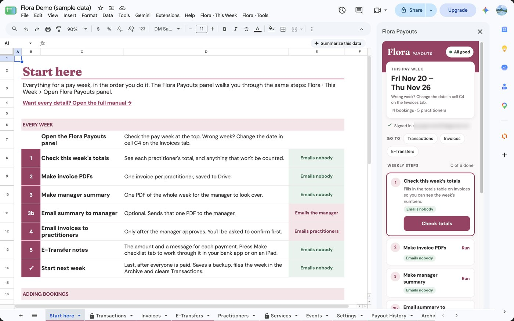
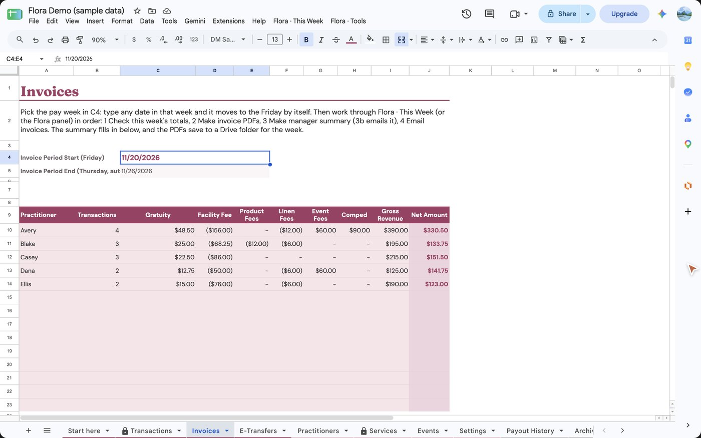
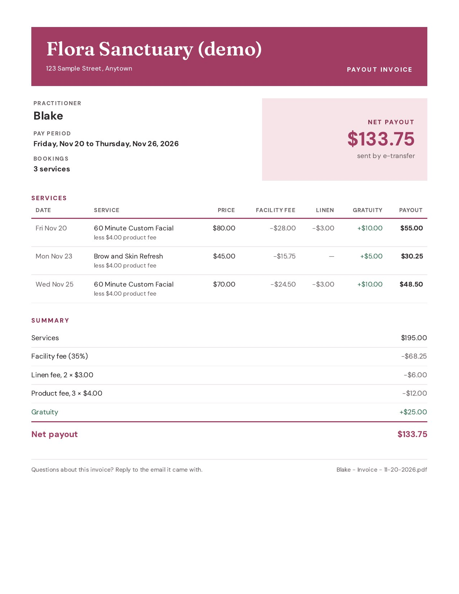
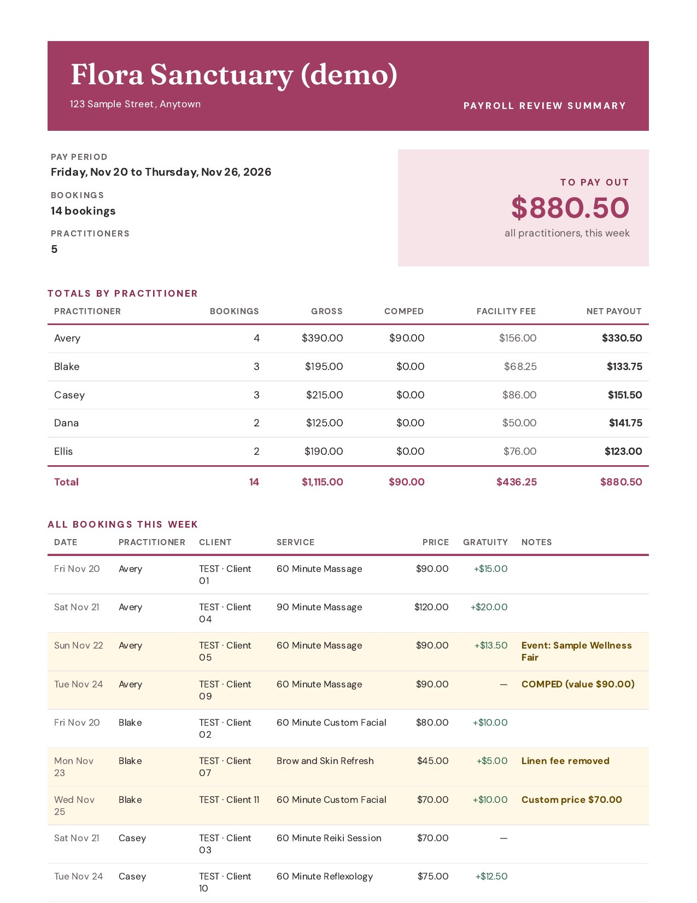
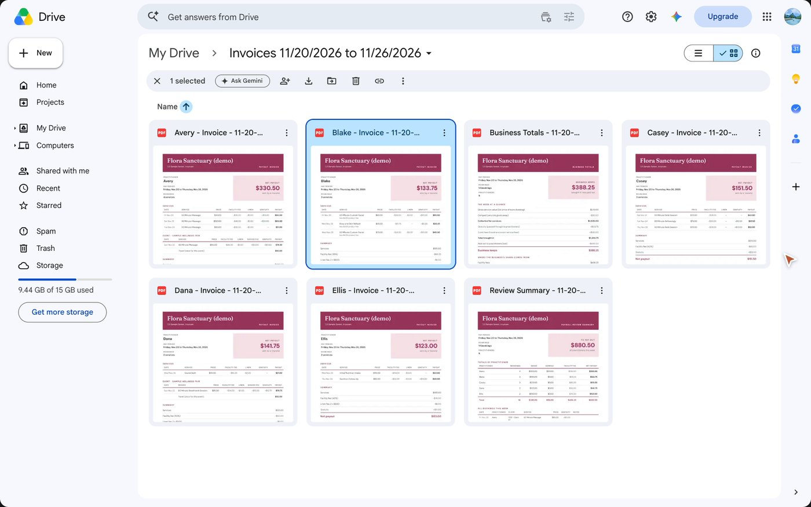
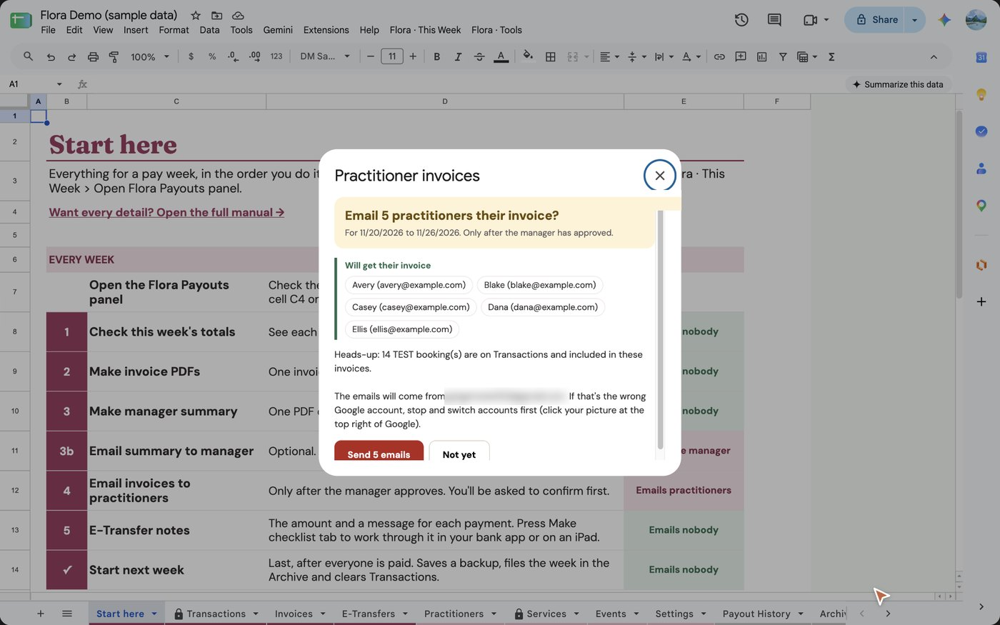
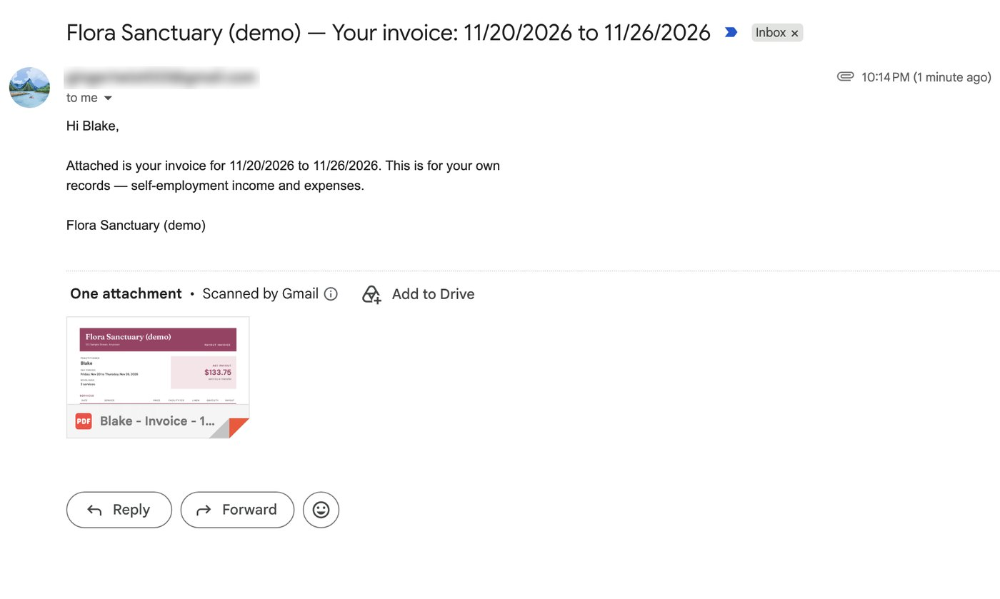
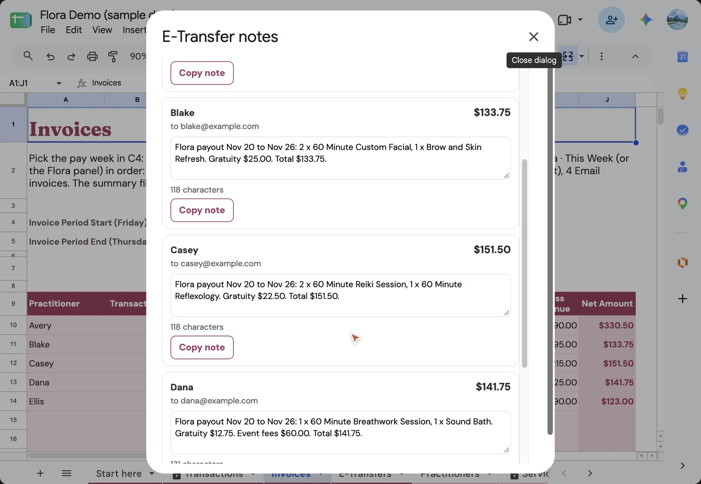
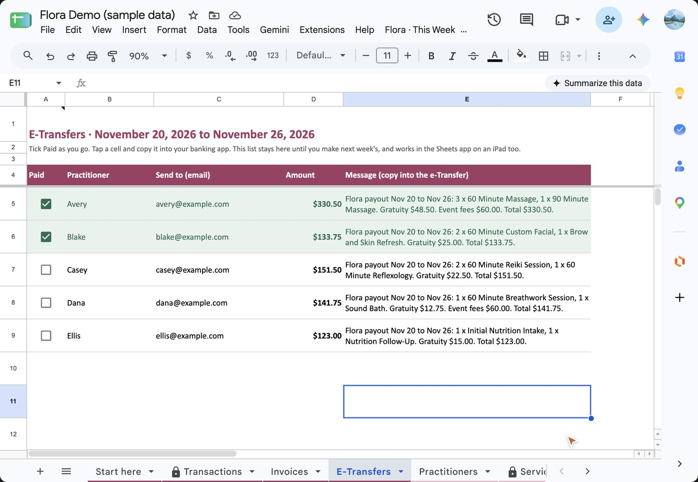
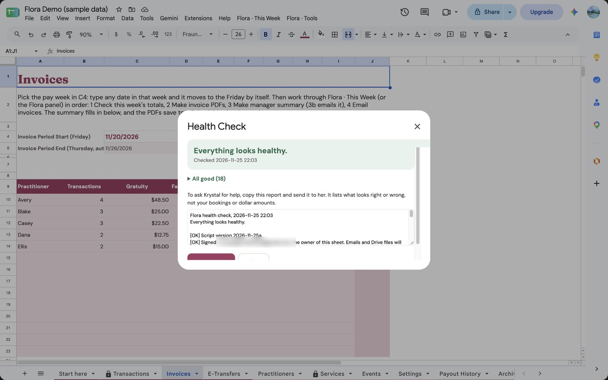

# Flora Invoices

A weekly payout and invoicing tool for a wellness centre, built in Google Sheets and Google Apps Script.
The manager logs a week of bookings and the tool produces each practitioner's invoice, a manager review
summary, e-transfer notes and an archive. A side panel shows which step is done and which needs review.

I designed it for Flora Sanctuary and directed Claude Code, which wrote the code. The design decisions
in this README are mine.

> **Privacy by design.** The tool and the business's data are kept apart on purpose. The manager runs
> her own copy of the sheet, and I have never had access to it or to the business's real data. Updates
> reach her copy without that access, and the script never sends data back to me. Everything in this
> repo, including the sample data, is made up, and all rates and fees are placeholders.

## See it

All screenshots come from a demo copy with made-up practitioners, clients and placeholder rates.

**The side panel** walks the manager through the week in order and ticks each step only when it worked.



**This week's totals** fill in on the Invoices tab before anything is made or sent.



**Each practitioner's invoice** lists every booking, and the Payout column adds up to the net payout.



**One review summary** for the manager, instead of opening every invoice.



**Saved to Drive** in a folder for the pay week.



**Nothing is emailed without a clear confirmation** that says who gets what.





**E-transfer notes** are written from the week's figures, and the E-Transfers tab tracks who's been paid.





**The Health Check** explains problems in plain words, and its report holds no bookings or amounts.



---

## The problem

A wellness centre pays its practitioners every week. Each payout depends on the service price, the
practitioner's share, linen and product fees, event travel and service fees, gratuities, and the odd
comped booking or custom price. The manager was working all of this out by hand. Mistakes cost trust,
and the practitioners had no easy way to check their own totals.

The practitioners are all self-employed, so they need accurate records of what they earned and what
was deducted. Those records weren't being provided.

I'm one of those practitioners. Many of the features here exist because I needed these resources
myself, and I saw an opportunity to build a robust, custom tool that would provide them for everyone.

The person running the tool is not technical, may work on an iPad, and doesn't read instructions. If
she gets lost, she stops using the tool. So my goal was a tool that is easy to follow, foolproof, and
fills in the gaps that weren't being handled.

## What it does

- **A mini database of services:** the Services tab holds each practitioner's services, their types and
  prices. Dependent dropdowns on Transactions use it, so nobody has to look up a price or detail, and
  every figure comes from one place.
- **Weekly flow in order:** preview totals, make invoice PDFs, make one manager review summary, email
  invoices, write e-transfer notes, then start the next week (back up, archive, clear, move the date on).
- **Invoices a practitioner can check:** each PDF lists every booking with its fees and its payout,
  and the Payout column adds up exactly to the net payout. A short ledger (services, less fees, plus
  gratuity and bonuses) shows the same total another way.
- **One review instead of many:** the manager checks one summary PDF of the whole week instead of
  opening every invoice. Nothing is emailed until its own button is pressed.
- **Business reports:** business totals for any week, and a summary for any past week.
- **E-transfer notes:** for each practitioner, the message to send with the payment is generated from
  the week's figures, so it is factual and gives proper context. An E-Transfers tab lists every payment
  with its message and a Paid tick box, and works in the iPad Sheets app.
- **Accurate records for self-employed practitioners:** every practitioner gets an invoice that shows
  each booking, fee and gratuity, and the totals are archived week by week.
- **Side panel:** a GUI-style flow beside the sheet. It shows this week at a glance, the steps in
  order with each one ticked only when it really succeeded, and a health pill, so nobody has to know
  which step comes next.
- **Health Check:** catches the silent ways the numbers could be out of date or wrong, and explains
  each one in plain words: a data mismatch between the sheet and the invoice math, bookings dated
  outside the pay period, bookings changed after the PDFs were made, entries typed twice, formulas typed
  over, services with no price, missing emails, the wrong Google account and more. Its report holds
  counts and row numbers only, so it can be sent to the developer without sharing bookings or amounts.
- **Safety nets:** every calculation lives on its own hidden, protected sheet, so the real formulas
  can't be broken by accident. Also a backup copy before each new week, guards on every typed or
  pasted date, refusals to send invoices that are out of date, and warnings before anything that
  can't be undone.
- **Old invoices removed:** remaking the PDFs trashes the week's invoice for anyone who no longer has
  bookings, so an out-of-date invoice can't be emailed by mistake.
- **Wrong-account warning:** emails go out from, and PDFs are saved to, whichever Google account is
  signed in. The panel and the Health Check flag a mismatch with the sheet's owner, a problem that
  came up for real when the manager was signed in to a different account.
- **Bring over data from an old sheet:** the manager starts each new version as a fresh copy and pulls
  her own practitioners, services, settings and history across from her old copy, matched by column
  heading. This is how updates reach her without me ever seeing her data.

**Estimated impact.** These are best-guess figures, not measurements. For a team of about 15
practitioners, a weekly payout run that took an estimated 3 to 4 hours by hand (working out each
share and fee, writing invoices and payment messages) now takes about 30 minutes, and every
practitioner gets an itemized invoice they can check.

## Version history

Most of these changes came from my own knowledge of the industry, the weekly flow, what practitioners
need and where the client struggled. Where a change answered something the client actually said, it is
marked **Feedback**.

### Version 1: the invoice structure
- **Need:** turn a week of bookings into accurate practitioner invoices.
- **Change:** a Settings tab for rules and prices, a Services tab as the single source of truth, a
  Transactions tab that grows by rows, and a PDF invoice for each practitioner.
- **Change:** event fees as a per-booking toggle: an Event column on Transactions applies that event's
  fees to the booking.

### Version 2: reports and a cleaner invoice run
- **Feedback:** using version 1, the client asked for reports.
  **Change:** business reports alongside the original invoices: a manager review summary, so the week
  can be checked in one PDF instead of invoice by invoice, and a business totals report.
- **Change:** duplicate invoice generation removed, and a single practitioner's invoice can be
  generated on its own.
- **Change:** validation started becoming more robust, beginning with strict inputs on Transactions.

### Version 3: a guided workflow with an app feel
- **Feedback:** the client wasn't using the invoices, because she thought she had to go through every
  one of them. The review summary that solves this had shipped in version 2, but she hadn't found it.
  **Change:** I clarified the pain points and created a guided workflow. The one menu became two
  custom menus: one for the weekly flow in order, and one for reports and under-the-hood fixes. Every
  step now says plainly whether it emails anyone or not.
- **Feedback:** the client broke the pay-week date and then couldn't save or edit it. The likely cause
  was a data type problem: typing the date instead of using the date picker can leave text in the cell
  instead of a real date.
  **Change:** validation hardened so a mistake like that fixes itself instead of locking her out. The
  pay-week cell reads typed and pasted dates, snaps any date to its Friday, and puts the last good week
  back if what's typed is junk. Rows past the limit are reported instead of ignored, a Health Check
  explains problems in plain words, and a backup is made before each new week.

The rest of version 3 came from my own choices as the developer, not from client requests:
- **Change:** I saw payments going out with messages like "1 massage, 1 facial plus tips", so I
  automated another routine task. The message for each e-transfer is generated from the week's figures,
  so it is factual and gives proper context, and an E-Transfers tab lists every payment with its message
  ready to copy and a Paid tick box.
- **Change:** a side panel, the biggest change in this version. It gives the sheet an app feel and a
  GUI-like flow: it shows which step is complete or needs review and what comes next, instead of
  expecting someone to know the order, even though the steps were already documented and numbered
  in the menu.
- **Change:** feedback loops guide the user through each step: colour-coded results that lead with the
  outcome, red buttons for steps that can't be undone, and errors that explain themselves and end with
  an error report the manager can send to the developer.
- **Change:** archiving expanded, with room to grow so nothing breaks as the business gets busier:
  capacity grows to 500 bookings a week, 100 practitioners, 400 services and 100 events, and older
  sheets grow once, automatically, formulas and protections included. The archive stores plain values,
  so a later price change never rewrites a past week.
- **Change:** settings consolidated. The manager email used to live on the Invoices tab; it moved to
  Settings with the other business-wide values, by itself the next time the sheet opened, so every
  setting is in one place.
- **Change:** the theme was modernized: every tab, pop-up and PDF in one rose-and-blush style, and
  tabs grouped by how often they're used.

## Design decisions

These came from my knowledge of the industry, the weekly flow, practitioner needs and the client's
struggles, not only from feedback.

- **Rules and prices live in a Settings tab.** A change means editing a cell, not a formula.
- **The sheet grows by adding rows, not by editing formulas.**
- **The Services tab is the single source of truth.** It feeds dependent dropdowns, so a practitioner's
  service list only offers what they actually provide, at the price set in one place.
- **Event fees are a per-transaction toggle.** A booking is tagged to an event, and the fees follow.
- **Pay stubs are built so the payee can check their own totals.** Every fee is shown per booking and
  again in a ledger that adds up to the net payout.
- **Prevent, detect, recover.** I assumed the sheet would be broken in ways I couldn't predict, and
  that wouldn't be the user's fault. So the safety work has three layers. **Prevent:** input rules,
  dropdowns, locked formulas and one source of truth for prices. **Detect:** the Health Check and
  plain-language reports of anything skipped or out of place. **Recover:** a backup before each new
  week, steps that are safe to run twice, and an archive that stores plain values.
- **Harden the sheet before rebuilding it as an app.** I wanted to make sure the basics worked first.
  The manager also likes spreadsheets, and I expect more resistance to a new app unless moving her
  details across were truly easy. A proper app would also need authentication, privacy and cloud
  resources that I don't have in place yet, so the spreadsheet stays until those are ready.
- **Take out the friction.** A big piece of the design was removing every step the manager would
  otherwise do by hand: looking up prices, working out fees, writing payment messages.
- **Calculations live on their own protected sheet.** The manager types inputs; the formulas sit on a
  hidden, locked Calculations tab where they can't be typed over or deleted by accident.
- **The tool is separate from the data.** See the privacy statement at the top.
- **I asked design questions before larger rebuilds.**

## Setup

You need a Google account, [Node.js](https://nodejs.org) and
[clasp](https://github.com/google/clasp) (Google's Apps Script command-line tool).

1. Create a Google Sheet with these tabs: Settings, Practitioners, Services, Events, Transactions,
   Invoices, Calculations, Archive, Payout History and Send Log. The column headings are in
   [sample-data](sample-data/). The calculated columns and the hidden Calculations tab come from the
   template sheet, which isn't in this repo yet (see What's next).
2. In the sheet, open Extensions > Apps Script and note the script ID from Project Settings.
3. In this folder, sign in, link the project and push the code:
   ```sh
   npm install -g @google/clasp
   clasp login
   echo '{"scriptId":"<your-script-id>","rootDir":"src"}' > .clasp.json
   clasp push
   ```
   `.clasp.json` is git-ignored, so your script ID never ends up in the repo.
4. Reload the sheet. Two menus appear: **Flora · This Week** and **Flora · Tools**. Approve the
   permissions the first time.
5. Fill Settings, Practitioners and Services from the sample data, then use **Flora · Tools > Add test
   bookings** to try a week safely. **Clear test bookings** removes exactly those rows.

Run the checks (pure helpers, no Google account needed):

```sh
node --test tests/*.test.js
```

## How it was built

- **Stack:** Google Sheets, Google Apps Script (V8), Claude Code.
- **Roles:** I designed the tool, set the requirements, made the decisions and tested every version.
  Claude Code wrote the code under my direction. I reviewed each change on my own copy of the sheet
  before it was released.
- **Workflow:** versions 1 and 2 were built with Claude and pasted into the sheet. For version 3 I moved
  to Claude Code with clasp and git, so every change was a reviewed commit pushed to my development copy.
- **How I directed the AI:**
  - Questions before building: Claude Code asked design questions before any larger rebuild, and I
    answered them before work began.
  - Mockups first: the new invoice was designed as a mockup and approved before any code changed;
    the reports were then restyled to match.
  - Small, reviewable steps: one tab or feature at a time, checked on my copy before the next.
  - Audits: I had the whole script audited in batches for gaps and fragile spots, then fixed them.
  - Tests for the logic: pure functions with Node checks, so changes can be verified without Google.
  - I approve every push: nothing reaches the live sheet until I say so.
- **Testing:** the logic that doesn't need Google (date parsing, capacity growth, invoice layout,
  duplicate detection, tab order, invoices adding up and more) is split into pure functions with 47
  Node checks. Everything else is tested on my own copy of the sheet using clearly labelled test bookings.
- **Size:** about 5,200 lines across 18 script files and one HTML panel.

## What's next

- A short demo video for the manager, built from real screenshots of my copy with test bookings.
- Release updates through an Apps Script library I own, so the manager's copy updates itself and I
  still never need access to it.
- Share my working template as a public copy link, so the setup above is a single copy. My own copy
  is built as that template: it holds no business data, and Add / Clear test bookings in the menu let
  anyone try a full week safely.

## Repo layout

```
src/           Apps Script source (.gs), the side panel (Panel.html) and the manifest
tests/         Node checks for the pure helpers
sample-data/   Made-up sample entries for each tab
docs/          Screenshots and the demo recording (placeholders for now)
```

© 2026 Krystal Blanchette. All rights reserved. The code is shared to show my work. Please ask
before reusing it.
