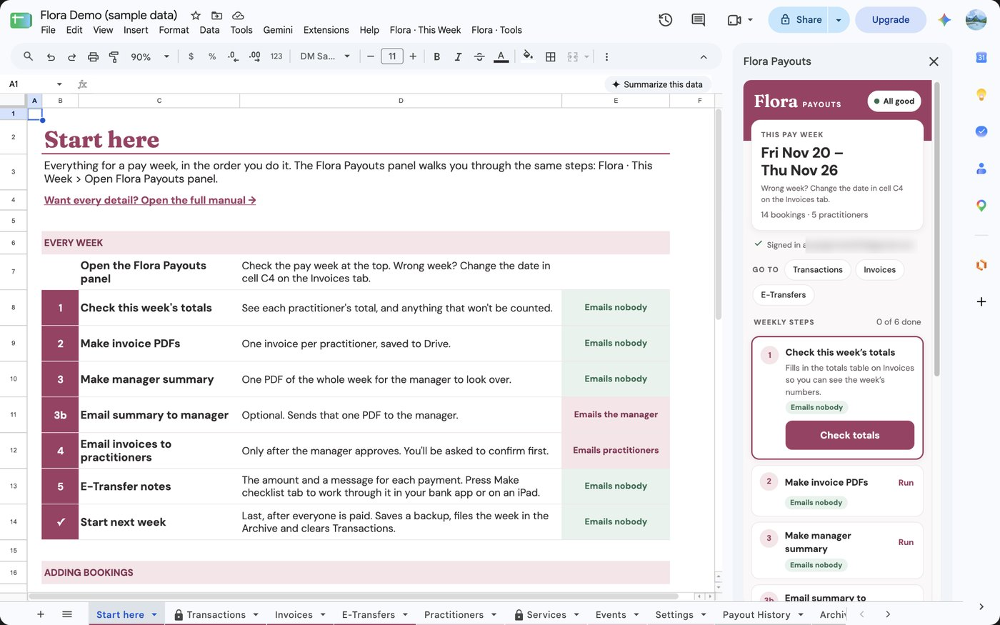
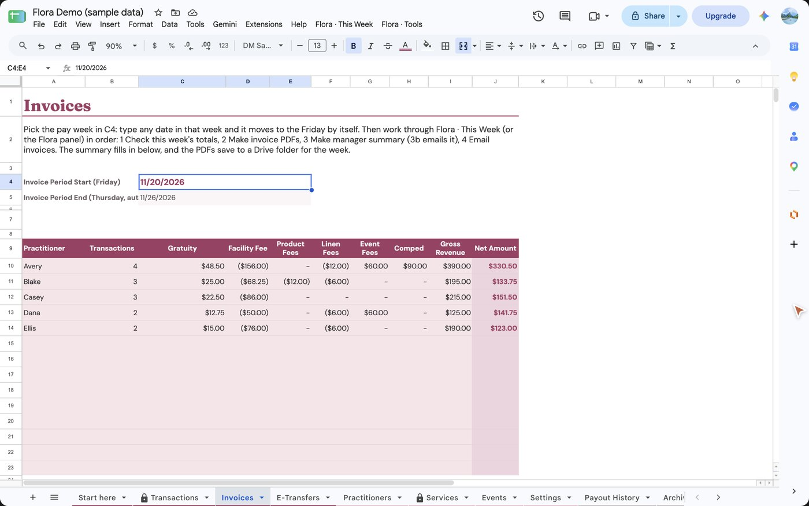
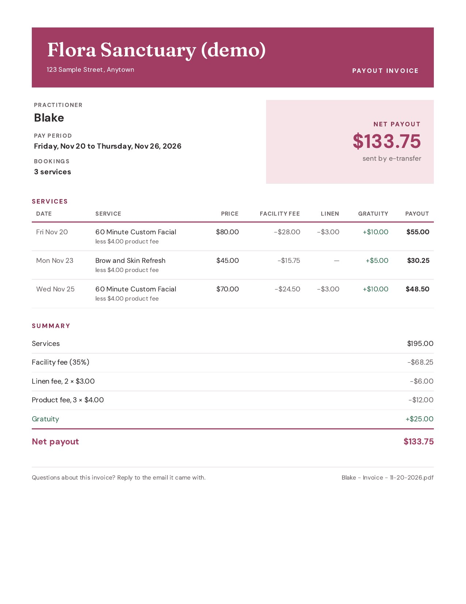
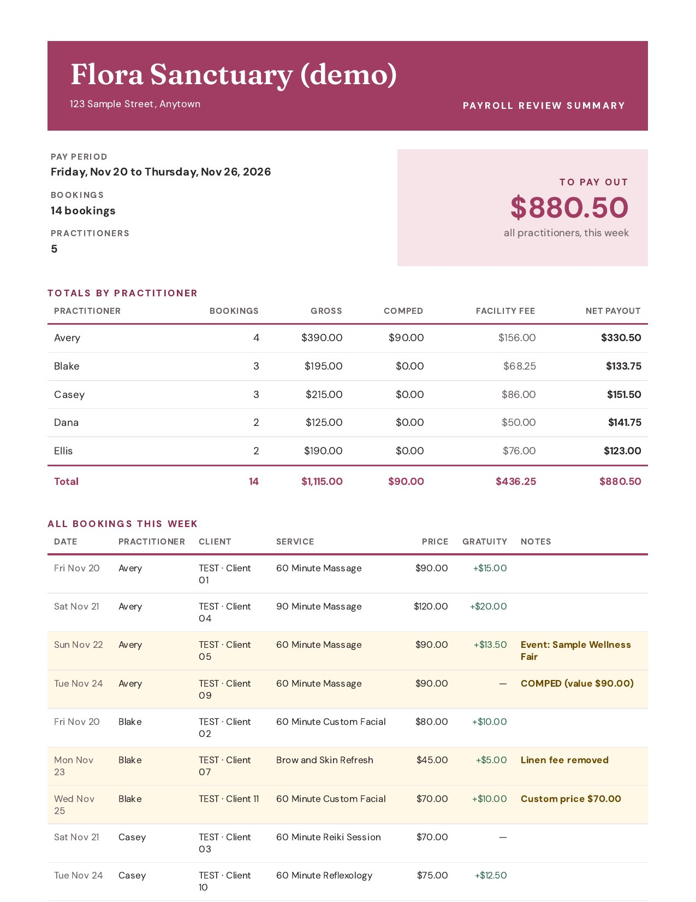
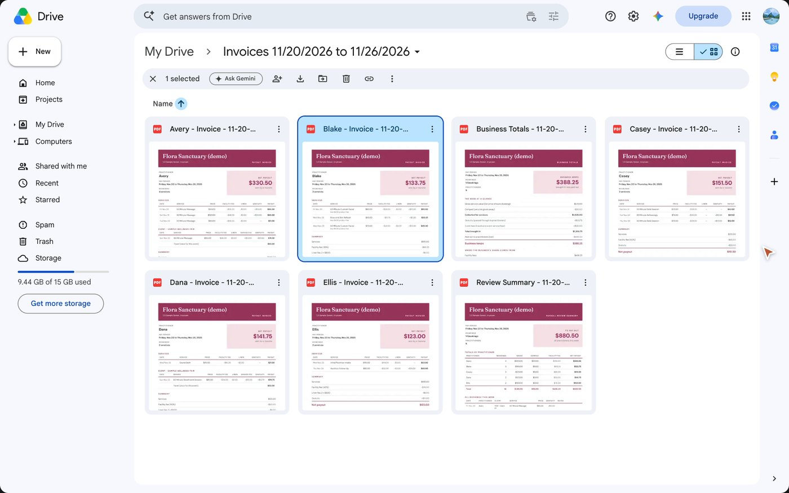
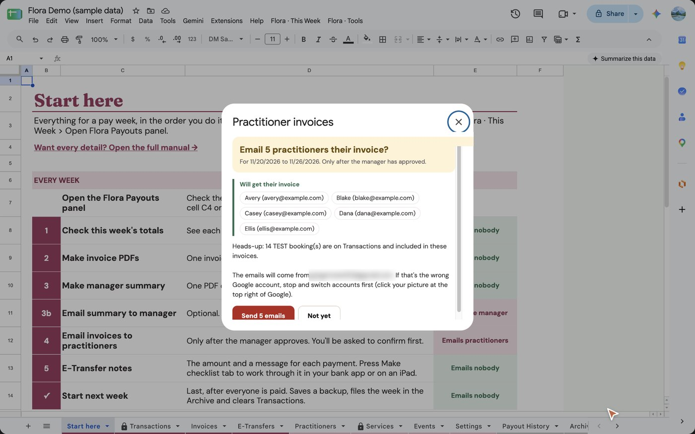
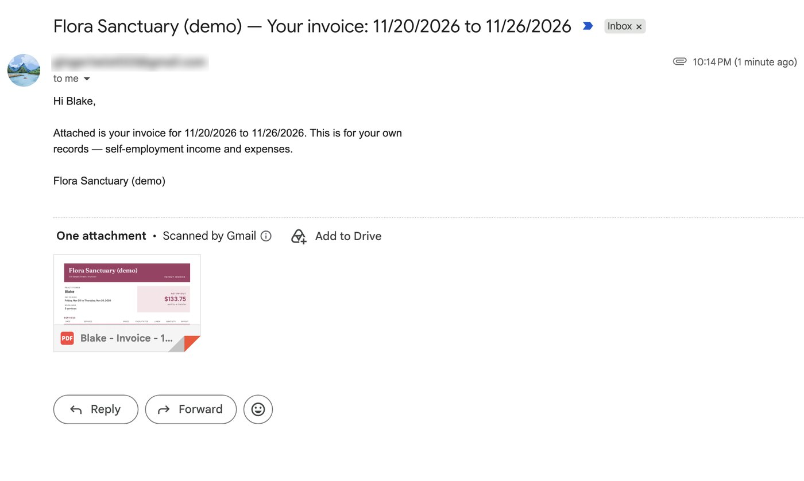
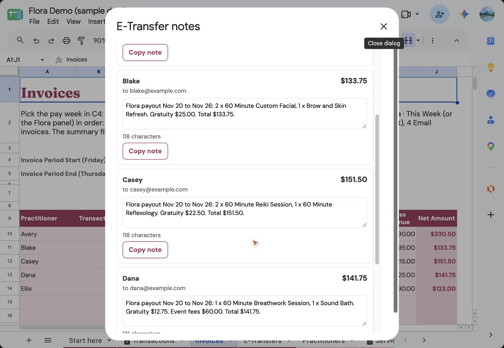
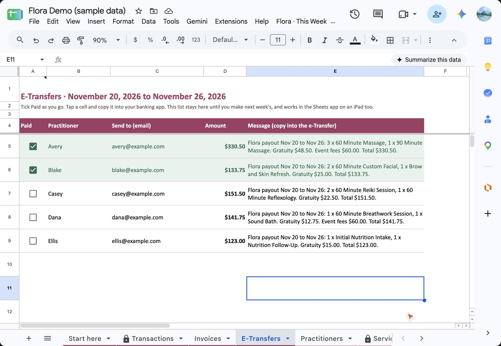
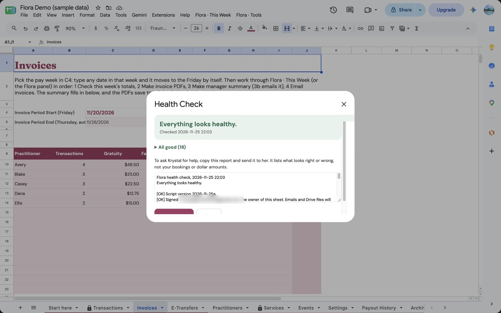

# Screenshot tour

All screenshots come from a demo copy with made-up practitioners, clients and placeholder rates.

**The side panel** walks the manager through the week in order and ticks each step only when it worked.

**This week's totals** fill in on the Invoices tab before anything is made or sent.

**Each practitioner's invoice** lists every booking, and the Payout column adds up to the net payout.

**One review summary** for the manager, instead of opening every invoice.

**Saved to Drive** in a folder for the pay week.

**Nothing is emailed without a clear confirmation** that says who gets what.

**E-transfer notes** are written from the week's figures, and the E-Transfers tab tracks who's been paid.

**The Health Check** explains problems in plain words, and its report holds no bookings or amounts.

[Back to the README](../README.md)
